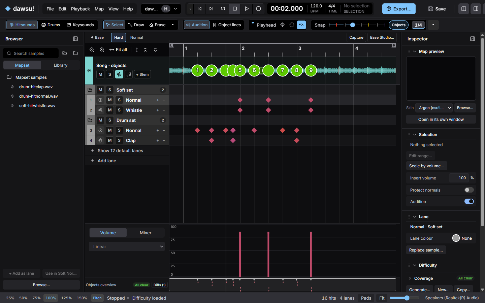
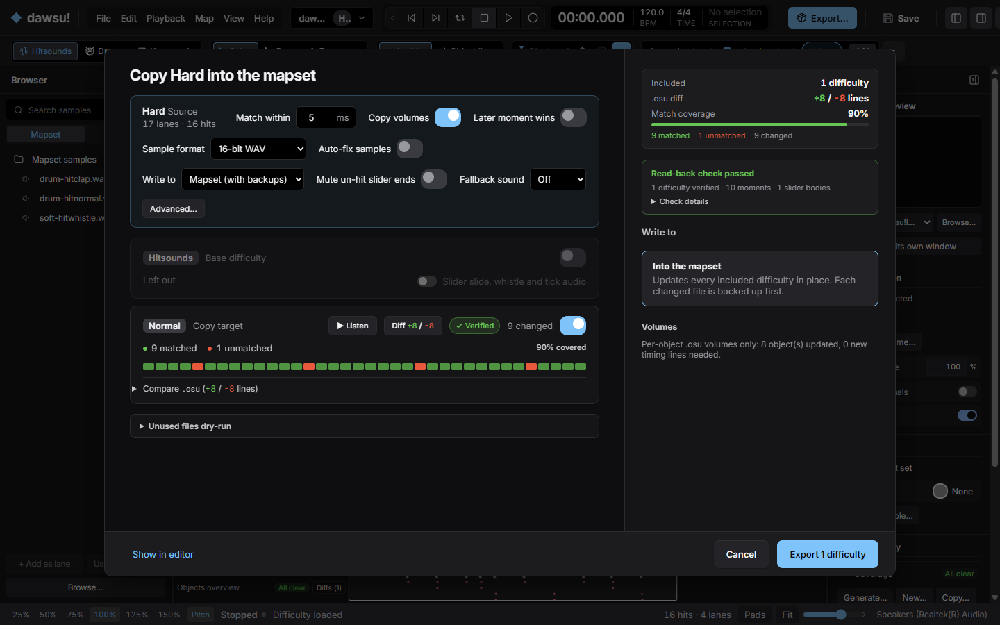

# dawsu!

A desktop hitsound and keysound editor built for osu! mappers. **dawsu!** turns every sample in your mapset into a timeline lane right under the song waveform and gameplay objects so you can draw, balance, share across difficulties, and export safely.

> [!NOTE]
> **v1.2 Alpha** — Available for Windows 10/11 (x64). Downloads are on the [GitHub Releases page](https://github.com/YogeGod/dawsu-rs/releases) as a Setup installer and Portable ZIP (always verified against `SHA256SUMS.txt`).

## Quick Start

1. Download the Setup installer or Portable ZIP from the [Releases page](https://github.com/YogeGod/dawsu-rs/releases) and open **dawsu!**.
2. Complete the **Ready** checklist on the Start screen (**Audio**, **Songs folder**, and **Shortcuts** — pick **osu! editor controls** or **DAW-like keys**).
3. Click **Try practice mapset** to explore a built-in 2-difficulty sandbox without touching any of your maps, or pick any mapset from your **Songs folder** search.

New to dawsu!? Read [Setting Up](docs/wiki/Setting-Up.md) and walk through [First Project](docs/wiki/First-Project.md).

## What You Can Do

- **Start fast with 3 mapset paths:** Search your osu! Songs folder right from the Start screen, drag and drop a `.osu`, `.osz`, or mapset folder, use **Open from osu!**, or click **Try practice mapset**. Start a blank `[Hitsounds]` difficulty with **Custom samples only** or **12 osu! default lanes**, or edit any difficulty directly.
- **Hitsound timeline editing:** Draw, select, erase, mute, grab, range-edit, and ramp hits across real sample lanes synced to the song waveform and gameplay objects. Switch between **Grid**, **Grid relative**, and **Objects** snap, stamp patterns with **Rhythm gallery**, tap hits live with `Numpad 1–9` or `A–L`, or use beat step-sequencer **Pads**.
- **Volume, Mixer & playback speed:** Shape per-hit loudness in the **Volume** lane, balance individual lanes in the **Mixer**, audition or solo lanes, loop between L/R locators, and slow passages down to **50%** or **75%** with pitch preservation.
- **Shared Base Layer across difficulties:** Capture a difficulty as the mapset's **Shared Base** and project it across your spread with live `matched`, `empty`, and `orphaned` counts, non-destructive per-difficulty **Lane rules**, and green-line-only **Volume curves** that create zero extra sample mixes.
- **Drums, AI Drum Stems & Keysounding:**
  - Switch to **Drums** mode with 11 built-in drum map presets, host Drum VST3 instruments, and bounce kits with a `.osz` 10 MB ranking-size gauge.
  - Detect kicks and snares with **Drum hit detection…** or customize detection stages visually in **Node graph…**.
  - Optionally isolate drums locally on your CPU with **Separate drums (AI)…** (`T` flips between Song and Drums; no audio is ever uploaded).
  - Compose melodic keysounds in the inline **Keysounding Piano Roll** using the built-in `.sf2` / `.sfz` sampler, VST3 instruments, musical typing (`Alt+K`), live MIDI recording, MIDI import/export, mania hitsound import, and deduplicated bouncing.
- **Verified Save & Export Review:** Untouched `.osu` lines stay byte-identical on **Save** (`Ctrl+S`), backups are saved outside your mapset folder (with **Revert mapset to original…** and **Undo revert**), and **Export…** (`Ctrl+E`) gives you target coverage bars, **▶ Listen** auditioning, line-by-line `.osu` diffs, Ranking Criteria sample auto-fix, and a 4-part pre-write read-back check.

- **osu! integration & auto-updates:** Open your active map with **Open from osu!**, keep edits safe when osu! saves externally, reload osu!stable (`Ctrl+L`) or osu!lazer after saving, and update safely with `SHA256SUMS.txt` verification.

## Guides & Documentation

| Guide | What it covers |
| --- | --- |
| [Setting Up](docs/wiki/Setting-Up.md) | Installing on Windows, audio output, Songs folder, shortcuts, and connecting with osu! |
| [First Project](docs/wiki/First-Project.md) | Using the built-in practice mapset, navigating the timeline, placing hits, and saving |
| [Shared Base & Export](docs/wiki/Shared-Base-and-Export.md) | Multi-difficulty Shared Base, Lane rules, green-line Volume curves, and Export Review |
| [Drums, Stems & Keysounds](docs/wiki/Drums-Stems-and-Keysounds.md) | Drum VST3 kits, AI drum stems, Drum Hit Detection, Node Graph, Piano Roll, and MIDI |
| [FAQ](docs/wiki/FAQ.md) | File safety, backups, osu!lazer/osu!stable rules, updates, and common questions |
| [Reporting Bugs](docs/wiki/Reporting-Bugs.md) | Finding crash logs, writing clear bug reports, and requesting features |

## Platform Support & Alpha Status

- **Windows 10/11 (x64):** Supported today (Setup installer and Portable ZIP).
- **macOS & Linux:** Planned; builds and runtime checks are not yet available.

See [FEATURE-COVERAGE.md](FEATURE-COVERAGE.md) for the detailed capability and verification status of every feature.

## Your Files & Credits

- **Mapset safety:** Opening a mapset never edits its files. Backups, Shared Base data, cached stems, projects, and crash logs are stored in `%LOCALAPPDATA%\dawsu-rs`, outside your osu! Songs folder.
- **Default sounds:** dawsu! ships osu!'s 21 default hit and slider sounds unchanged from `ppy/osu-resources` under the **CC BY-NC 4.0** licence (non-commercial — no build of dawsu! may be sold). See [THIRD-PARTY-NOTICES.md](THIRD-PARTY-NOTICES.md).

---

*Building from source or contributing? See [docs/DEVELOPMENT.md](docs/DEVELOPMENT.md).*
