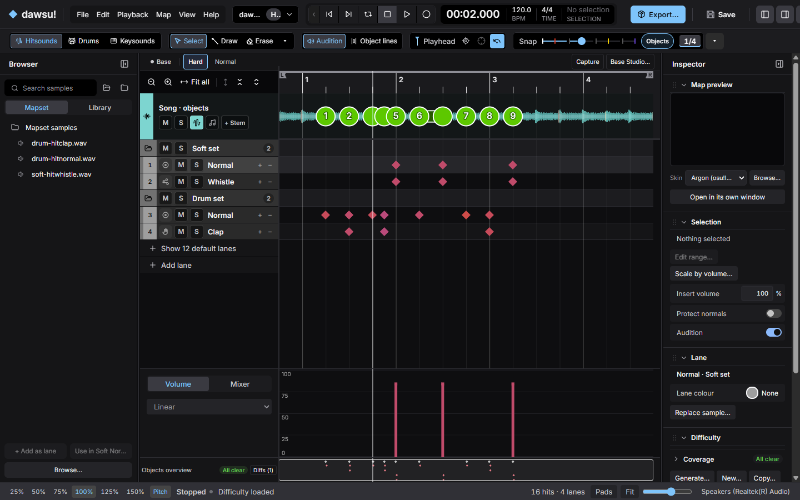

# First Project Walkthrough

This guide walks you through a complete hitsounding session in **dawsu!**, from opening the built-in practice mapset (or your own map) to balancing volumes and saving safely. See the full [wiki](wiki/First-Project.md) for all guides.

## 1. Open the Practice Mapset or Your Own Map

1. Launch **dawsu!**.
2. To experiment with zero risk, click **Try practice mapset** on the Start screen. This opens a temporary 2-difficulty sandbox (`dawsu! Studio - dawsu! Demo Track [Hard]` and `[Normal]`) with a backing song and three samples (`drum-hitnormal.wav`, `drum-hitclap.wav`, `soft-hitwhistle.wav`) — it never touches your real maps, recent list, or backups.
3. To work on your own mapset instead:
   - Click any mapset in **Songs folder** on the Start screen to open the intake card, or drag and drop a `.osu`, `.osz`, or mapset folder anywhere onto the window, or use **Open map…** / **Import .osz…** / **Open from osu!**.
   - Choose one of the three intake paths:
     - **Start a dedicated `[Hitsounds]` diff → Custom samples only:** Starts blank with `0` lanes so you only see the `.wav` files you add or drop in.
     - **Start a dedicated `[Hitsounds]` diff → 12 osu! default lanes:** Starts blank with osu!'s 12 default skin sounds pre-organized in Drum Map order.
     - **Or edit a difficulty directly:** Opens an existing osu!standard difficulty with **Objects** snap and its existing sample lanes.

## 2. Navigate the Timeline & Listen

- **Play & seek:** Press `Space` to play or pause, click the timeline ruler to move the playhead, or drag across the upper ruler to set **L/R locators** and toggle **Cycle** looping.
- **Slow down tricky passages:** Use the bottom-left speed buttons (**50%**, **75%**, **100%**, **125%**, **150%**) to slow down or speed up playback. Toggle **Pitch** to keep the song's original pitch while slowed down.
- **Isolate drums while listening:** Click **+ Stem** on the `Song · objects` row (or **Playback → Separate drums (AI)…**) to generate a local CPU drum stem, then press `T` anytime to flip between the full song and drums only.
- **Overview & snap:** Drag across the **Objects overview** strip at the bottom to jump anywhere in the song, and switch **Snap** between **Grid** and **Objects** on the top ribbon.

## 3. Place, Tap & Balance Hits

- **Draw hits:** Pick **Draw** (`2` in DAW-like keys, or hold `Alt` while using **Select**) and click or drag across a lane to place hits on the grid or objects.
- **Step-sequencer Pads & Live Tapping:** Toggle **Pads** in the bottom status bar for beat-step pads on each lane, press `Numpad 1–9` to trigger lanes live, or arm **Tap record (`A–L / Numpad 1–9`)** via **Playback** to record taps in one Undo step.
- **Volume, Mixer & Inspector:** Drag bars in the **Volume** lane (or switch to **Mixer** for per-lane Mute/Solo/faders), and use the **Selection** card in the Inspector to adjust sample sets (`Normal | Soft | Drum`), additions (`W | F | C`), slider body sounds, and **Rhythm gallery** presets.

## 4. Save Safely & Export Across Difficulties

- Press `Ctrl+S` (**File → Save**) at any time — untouched `.osu` lines stay byte-identical and backups are kept outside your mapset folder.
- Use **Map → Shared Base layer…** and **File → Export…** (`Ctrl+E`) to project hitsounds across difficulties, apply non-destructive lane rules or green-line volume curves, audition targets with **▶ Listen**, and verify every `.osu` file with the pre-write read-back check. See [Shared Base & Export](wiki/Shared-Base-and-Export.md) for the full walkthrough.
