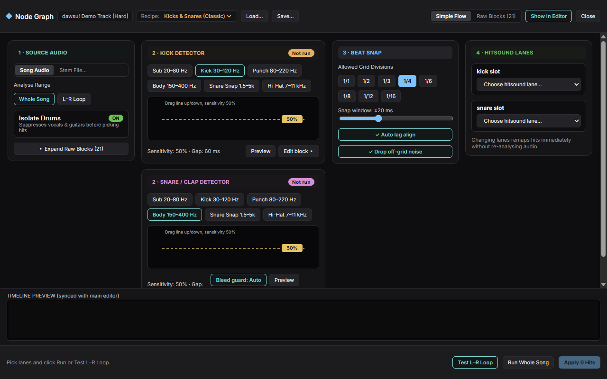

# Drums, Stems & Keysounds

[Setting Up](Setting-Up.md) · [First Project](First-Project.md) · [Shared Base & Export](Shared-Base-and-Export.md) · [Drums, Stems & Keysounds](Drums-Stems-and-Keysounds.md) · [FAQ](FAQ.md) · [Reporting Bugs](Reporting-Bugs.md)

Beyond sample-lane editing, **dawsu!** includes drum kit mapping and VST3 hosting, optional local AI drum stem separation, visual drum detection via the Node Graph, and an inline Keysounding Piano Roll.

## 1. Drums Mode & Drum VST3 Kits

Switch the ribbon from **Hitsounds** to **Drums** (or use **View → Open drum map…**) to work in drum-kit rows instead of raw `.wav` filenames:

- **11 built-in drum map presets:** Includes `Default osu! kit (12 skin sounds)`, `Net0 hitsound kit`, `Full kit, all 12 samples`, and more. You can also import Cubase `.drm` files or save/load `.dawsudrum` drum maps (**Drum Map Editor**).
- **Drum Map Editor:** Test any drum row with **▶ Test**, bind pads with **MIDI Learn**, and assign choke groups (**None**, **A**, **B**).
- **Drum VST3 Instrument Bar:** Click **Scan VST3** to find installed VST3 drum instruments, select one to hear mapped lanes played live by your VST3 plugin, and open **VST3 Settings & State…** when needed.
- **Bounce VST3 Kit…:** Render your VST3 drum performance into osu!-ready hitsound samples:
  - Choose **Smart 3-Tier (Ghost / Mid / Hard)** or **Exact per volume**, and **Ogg Vorbis (`.ogg · -1.5 dBFS`)** or **16-bit WAV (`.wav · -1.0 dBFS`)**.
  - Enable **Auto-trim (-60 dBFS)** and **Uniform kit peak normalize**.
  - Watch the live **`.osz` size estimate** gauge against osu!'s `10.0 MB` ranking ceiling, preview individual rendered samples, then click **Commit Samples to `[Hitsounds]`**.

## 2. Optional AI Drum Stem Separation (`Separate drums (AI)…`)

To make dense tracks easier to hear when mapping drums or percussion:

- Click **+ Stem** on the `Song · objects` row or open **Playback → Separate drums (AI)…**.
- On first use, dawsu! downloads the verified HT-Demucs model (~166 MB) and ONNX Runtime into `%LOCALAPPDATA%\dawsu-rs` (always checked against pinned SHA-256 hashes) and splits the drums locally on your CPU. **Nothing is uploaded.**
- Press `T` anytime in the editor to flip playback between the full **Song** and the isolated **Drum stem**.
- Already have a drum stem `.wav`/`.mp3`/`.ogg`? Use **Playback → Attach drum stem…** to load your own file, or **Playback → Clear drum stem** / **Remove downloaded model** inside the dialog to free disk space.

## 3. Drum Hit Detection & Node Graph

dawsu! offers two ways to detect kicks, snares, and drum rhythms from either the song or a drum stem:

- **Quick review (`Map → Drum hit detection…`):** Pick **Song** or **Drum stem**, assign target lanes for **Kicks** and **Snares**, adjust **Sensitivity**, **Snap to objects within (ms)**, and **Beat grid**, audition/uncheck proposed hits in the review list, and apply them as one Undo step.
- **Visual pipeline (`Map → Node graph…`):** Open the dedicated Node Graph window to inspect and tune the detection chain in **Simple Flow** or **Raw Blocks** view:

- **4-stage Simple Flow:**
  1. **Source Audio:** Switch between **Song Audio** and **Stem File…**, pick **Whole Song** or **L–R Loop** (synced to your main editor locators), and toggle **Isolate Drums** (harmonic-percussive separation).
  2. **Detectors:** Choose frequency band presets, drag the golden sensitivity threshold line directly on the onset curve, and toggle **Bleed guard** or **Preview** to stream that stage's curve/events into the bottom **Timeline Preview** strip.
  3. **Beat Snap:** Pick allowed beat divisions (`1/1`–`1/16`), adjust **Snap window (±ms)**, and toggle **Auto lag align** or **Drop off-grid noise**.
  4. **Hitsound Lanes:** Remap kick/snare/hat slots to any hitsound lane immediately without re-analysing audio.
- Click **Test L–R Loop** or **Run Whole Song**, inspect proposals in **Review Hits**, and click **Apply Hits** (undoable in the main editor with `Ctrl+Z`). Save or load custom `.dawsugraph` recipes anytime from the top bar.

## 4. Keysounding Piano Roll, SoundFont / SFZ & MIDI

Click **Keysounds** on the ribbon (or **Map → Keysounds & VST3…**) to swap the main timeline area into the inline **Keysounding Piano Roll** (click **Back to Hitsounds** or press `Esc` to return):

- **Instruments without extra plugins:** Click **Load SFZ / SF2…** to load any `.sfz` or `.sf2` SoundFont directly using dawsu!'s built-in sampler (including SoundFont preset selection), or click **Scan VST3 → Load VST3** to drive a VST3 instrument. You can also test `.sf2`/`.sfz` files in **Preferences → MIDI Input & VST3**.
- **Composing & recording notes:**
  - Click in the piano roll grid to place notes, drag to move, drag the right edge to resize, right-click or press `Delete` to remove, and drag velocity bars underneath.
  - Toggle **Typing (`Alt+K`)** to play notes from your computer keyboard (`Z`/`X` shifts octave, `C`/`V` adjusts velocity).
  - Connect a hardware MIDI keyboard or drum pad in **Preferences → MIDI Input & VST3** and arm **MIDI Record** in the transport bar to record live against the playhead.
  - Import or export standard `.mid` files via **File → Import MIDI…** / **File → Export MIDI…** (or **Import `.mid…`** on the Keysounds bar), or import keysounds from an osu!mania difficulty via **File → Import mania hitsounds…**.
  - Save and reopen keysound sessions as `.dawsuks` projects.
- **Track tools & Chord Resolver:**
  - Mute (**M**) or Solo (**S**) tracks, toggle **Ghosts** (notes from audible sibling tracks) and **Object lines**, **Quantize 125 ms**, **Trim overlaps**, **Sync to objects**, and transpose (`-12`, `-1`, `+1`, `+12`).
  - When multiple notes land on the same osu!standard hit object, click the **chords to resolve** badge to open the **Chord Resolver** (**Flatten Chord to 1 Polyphonic Sample (Recommended)** or **Top Note Only** — no storyboard `.osb` samples required).
- **Bounce & Deduplicate… / Generate `[Keysounds]`:**
  - Set **Velocity buckets**, **Duration step (ms)**, **Flatten chords**, and **Format** (`Ogg Vorbis` or `16-bit WAV`).
  - Preview the deduplication savings (`N MIDI notes → M unique samples`) and `.osz` `10.0 MB` budget gauge, audition individual rendered samples, and click **Commit Keysounds to `[Hitsounds]`** (or **Generate `[Keysounds]`**).

---

**Next:** Check common questions in the [FAQ](FAQ.md).
