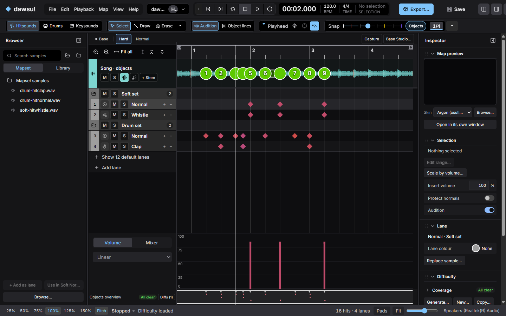

# First Project

[Setting Up](Setting-Up.md) · [First Project](First-Project.md) · [Shared Base & Export](Shared-Base-and-Export.md) · [Drums, Stems & Keysounds](Drums-Stems-and-Keysounds.md) · [FAQ](FAQ.md) · [Reporting Bugs](Reporting-Bugs.md)

This walkthrough takes you through a complete hitsounding session in **dawsu!**, from opening a mapset to balancing volumes and saving safely.

## 1. Open the Practice Mapset or Your Own Map

1. Launch **dawsu!**.
2. To experiment with zero risk, click **Try practice mapset** on the Start screen. This opens a temporary 2-difficulty sandbox (`dawsu! Studio - dawsu! Demo Track [Hard]` and `[Normal]`) with a backing song and three samples (`drum-hitnormal.wav`, `drum-hitclap.wav`, `soft-hitwhistle.wav`) — it never touches your real maps, recent list, or backups.
3. To work on your own mapset instead:
   - Click any mapset in **Songs folder** on the Start screen to open the intake card, or drag and drop a `.osu`, `.osz`, or mapset folder anywhere onto the window, or use **Open map…** / **Import .osz…** / **Open from osu!**.
   - Choose one of the three intake paths:
     - **Start a dedicated `[Hitsounds]` diff → Custom samples only:** Starts blank with `0` lanes so you only see the `.wav` files you add or drop in.
     - **Start a dedicated `[Hitsounds]` diff → 12 osu! default lanes:** Starts blank with osu!'s 12 default skin sounds pre-organized in Drum Map order.
     - **Or edit a difficulty directly:** Opens an existing osu!standard difficulty with **Objects** snap and its existing sample lanes.

> [!TIP]
> Need an interactive refresher inside the editor? Open **Help → Quick start tour** anytime for the 5-card walkthrough.

## 2. Navigate the Timeline & Listen

- **Play & seek:** Press `Space` to play or pause, click the timeline ruler to move the playhead, or drag across the upper ruler to set **L/R locators** and toggle **Cycle** looping.
- **Slow down tricky passages:** Use the bottom-left speed buttons (**50%**, **75%**, **100%**, **125%**, **150%**) to slow down or speed up playback. Toggle **Pitch** to keep the song's original pitch while slowed down.
- **Object lines & Map preview:** The `Song · objects` row shows the song waveform with gameplay circles, sliders, and spinners directly over your lanes. On the right, **Map preview** renders the beatmap in sync with the playhead (toggle in **View → Map preview** or pop it out with **Open in its own window**).
- **Isolate drums while listening:** Click **+ Stem** on the `Song · objects` row (or **Playback → Separate drums (AI)…**) to generate a local CPU drum stem, then press `T` anytime to flip between the full song and drums only.
- **Overview & snap:** Drag across the **Objects overview** strip at the bottom to jump anywhere in the song. On the top ribbon, switch **Snap** between **Grid** (beat divisions `1/1`–`1/16`, plus `1/5`, `1/7`, `1/9`, `1/12`, `1/64`, and `2/1`–`4/1` in the `▾` menu) and **Objects** (snaps directly onto hit objects).

## 3. Place, Tap & Edit Hitsounds

Every sample file in your mapset appears as a timeline lane grouped under `Normal set`, `Soft set`, and `Drum set`:

- **Draw hits:** Pick **Draw** (`2` in DAW-like keys, or hold `Alt` while using **Select**) and click or drag across a lane to snap hits onto the grid or objects.
- **Right-click / More tools (`▾`):** Switch among all seven tools — **Select**, **Draw**, **Erase**, **Mute**, **Grab**, **Range**, and **Ramp**.
- **Step-sequencer Pads:** Toggle **Pads** in the bottom status bar for clickable beat-step pads right on each lane row.
- **Tap hits live:** Press `Numpad 1–9` anytime to trigger visible lanes 1–9, or arm **Tap record (`A–L / Numpad 1–9`)** via **Playback** (or the round Record button in the transport bar) and tap along while playing — each take commits as a single `Ctrl+Z` Undo step.
- **Manage lanes & samples:**
  - Browse **Mapset** or **Library** samples in the left **Browser** panel, preview them, and click **+ Add as lane** or drag a sample directly onto a lane header.
  - Right-click any lane header (or press `Shift+F10`) to **Rename…**, **Replace sample…**, set **Lane colour…**, **Add numbered layer**, **Clone as next numbered variant**, **Alternate selected hits with next lane**, or **Delete lane…**.
  - Filter to only lanes that contain hits with **View → Used lanes only**, or collapse numbered variations under their base lane with **View → Collapse sample layers**.

## 4. Balance Volumes & Refine Selections

- **Volume lane:** Drag bars up or down in the **Volume** tab below the timeline to adjust hit volumes, or switch the **Ramp** shape dropdown (**Linear**, **Ease in**, **Ease out**, **S-curve**) and drag a smooth volume ramp across hits.
- **Mixer:** Switch the bottom panel tab from **Volume** to **Mixer** for per-lane **M** (Mute), **S** (Solo), gain faders, and live peak meters alongside the **Song**, **Hitsounds**, and **Master output** buses.
- **Selection Inspector:** Select one or more hits to adjust **Start** time, **Volume** slider, sample set (`Normal | Soft | Drum`), additions (`W | F | C`), and **Slider body sounds** (slide/tick sample set, whistle on slide, whistle sample set, body/head volume).
- **Rhythm gallery & Edit tools:** Click one of the **Rhythm gallery** chips in the Selection Inspector to stamp common rhythmic patterns (`Custom…` opens **Pattern stamp…**), or use **Edit → Quantize…**, **Repeat…**, **Edit range…**, and **Scale by volume…**. Keep **Protect hitnormals from deletion** on when you want to prevent accidentally erasing base hitnormals.

## 5. Save Safely & Move Across Difficulties

- Press `Ctrl+S` (**File → Save**) at any time. **dawsu!** writes byte-identical `.osu` output for everything you did not edit and stores backups outside your mapset folder in `%LOCALAPPDATA%\dawsu-rs`.
- If you ever want to roll back an entire mapset to the exact state it was in when dawsu! first opened it, use **File → Revert mapset to original…** (and **File → Undo revert** if you change your mind).
- Switch between difficulties using the difficulty dropdown in the top header or the **Base** strip above the timeline.

---

**Next:** Project your hitsounds across all difficulties and verify your export in [Shared Base & Export](Shared-Base-and-Export.md).
