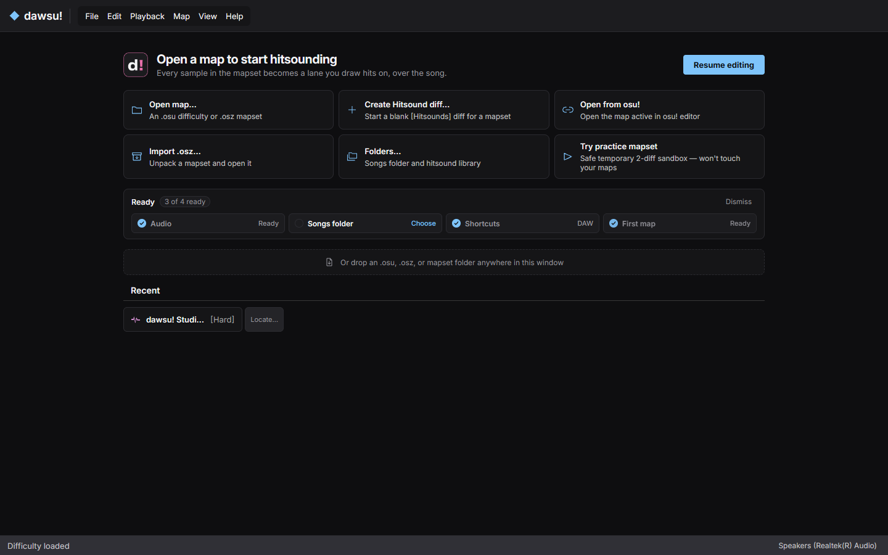

# Setting Up

[Setting Up](Setting-Up.md) · [First Project](First-Project.md) · [Shared Base & Export](Shared-Base-and-Export.md) · [Drums, Stems & Keysounds](Drums-Stems-and-Keysounds.md) · [FAQ](FAQ.md) · [Reporting Bugs](Reporting-Bugs.md)

This page walks you through installing **dawsu!**, configuring audio and your osu! Songs folder, picking shortcuts, and connecting with osu!.

## 1. Download & Install (Windows)

Download the latest Alpha build from the [GitHub Releases page](https://github.com/YogeGod/dawsu-rs/releases). Two Windows x64 packages are published for each release alongside `SHA256SUMS.txt`:

- **Setup Installer (`dawsu-v…-windows-x64-setup.exe`):** Installs per-user into `%LOCALAPPDATA%\Programs\dawsu` (no administrator rights required). During setup you can optionally create a Desktop shortcut or associate `.osu` and `.osz` files with dawsu!.
- **Portable ZIP (`dawsu-v…-windows-x64-portable.zip`):** Extract anywhere on your PC and launch `dawsu-tauri.exe`. Keeps a `portable.marker` file in its folder so updates know to stay portable.

> [!NOTE]
> **Windows SmartScreen:** Early Alpha builds are not code-signed, so Windows may show a *"Windows protected your PC"* prompt on first launch. You can verify the download's SHA-256 checksum against `SHA256SUMS.txt` on the Releases page before clicking **More info → Run anyway**.

Requirements: **Windows 10 or Windows 11 (64-bit)** with Microsoft Edge WebView2 Runtime (already included on Windows 11 and modern Windows 10 systems).

## 2. First Launch & the Start Screen Ready Checklist

When dawsu! opens for the first time, it asks you to pick a control style (**osu! editor controls** or **DAW-like keys**) — you can switch anytime in **Preferences**.

On the Start screen, the **Ready** bar tracks four quick setup steps:

1. **Audio:** Click the **Audio** pill (or **Playback → Audio output…**, or the speaker button in the bottom-right status bar) to pick your output backend (**WASAPI**, **DirectSound**, or **MME**), audio device, and buffer size (`10`–`500` ms).
   - Lower buffers feel tighter when auditioning or tapping hits live; increase the buffer if you hear clicks or dropouts on a busy project.
   - Stop playback before applying a new output device.
2. **Songs folder:** Click **Songs folder** (or the **Folders…** card on the Start screen) and point dawsu! to your osu! `Songs` directory.
   - dawsu! indexes your `osu!.db` / Songs folder locally so you can search thousands of mapsets by artist, title, mapper, difficulty, tags, or `BeatmapSetID` right on the Start screen.
   - In **Folders…** (or **Preferences → Folders**), you can also set a **Hitsound library** folder for your personal sample packs so they appear in the left-hand **Browser → Library** tab.
3. **Shortcuts:** Confirm **osu! editor controls** (wheel scrolls time, `Alt+wheel` zooms, osu! editor shortcuts) or **DAW-like keys** (wheel scrolls lanes, `Ctrl+wheel` zooms in time, `1–4` pick tools).
   - View or rebind any shortcut in **Preferences → Shortcuts** (or **Help → Shortcuts**).
   - Press `Ctrl+K` anywhere in the editor to open the **Command Palette** and search every menu command and shortcut.
4. **First map:** Click **Try practice mapset** on the Start screen for a safe, built-in 2-difficulty sandbox, or open any mapset from your **Songs folder**.

## 3. Connecting with osu!

dawsu! works alongside both **osu!stable** (including un!stable / Mapping Tools IPC) and **osu!lazer**:

- **Open from osu!:** Click **Open from osu!** on the Start screen (or **File → Open from osu!**).
  - For **osu!stable**, open the beatmap in the osu! editor (or run Mapping Tools IPC) and make sure your Songs folder is configured.
  - For **osu!lazer**, use **File → Edit externally** inside osu!lazer's beatmap editor first, then click **Open from osu!** in dawsu!.
- **Live external edit protection:** If you save changes in osu! while the same difficulty is open in dawsu!, dawsu! auto-reloads when clean or shows a **`.osu changed on disk`** banner with **Reload from disk** and **Keep my edits** if you have unsaved edits.
- **Reload osu! after Save:** Enable **Preferences → General → Reload osu! editor after Save** (or use **File → Reload in osu!** manually):
  - With **osu!stable** on Windows, dawsu! brings the matching osu! editor window forward and sends `Ctrl+L` + `Enter` to reload.
  - With **osu!lazer** `Edit externally`, dawsu! reminds you to click **Finish** in osu!lazer to apply your saved changes.

## 4. Interface Scale, Colours, Updates & Default Sounds

- **Interface scale:** Adjust from `90%` to `200%` in **Preferences → General** or press `Ctrl+=` / `Ctrl+-` (`Ctrl+0` resets to `100%`).
- **Colours:** Choose a preset colour scheme or customize grid, ruler, and editor colours live in **Preferences → Colours**.
- **Updates:** In **Preferences → Updates**, keep **Check GitHub Releases automatically when dawsu! starts** enabled or click **Check for updates** manually. Downloads are always verified against `SHA256SUMS.txt` before installing when you close dawsu!.
- **Default osu! sounds:** dawsu! ships osu!'s 21 default hit and slider samples (`Normal`, `Soft`, `Drum`) unchanged from `ppy/osu-resources` (CC BY-NC 4.0). If you configure a custom default samples folder, your custom samples take priority and the built-in sounds fill in anything missing.

---

**Next:** Walk through your first map in [First Project](First-Project.md).
