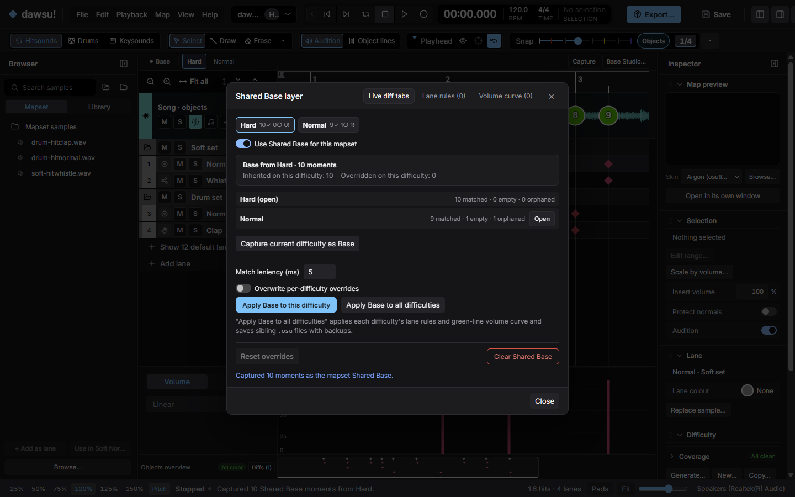
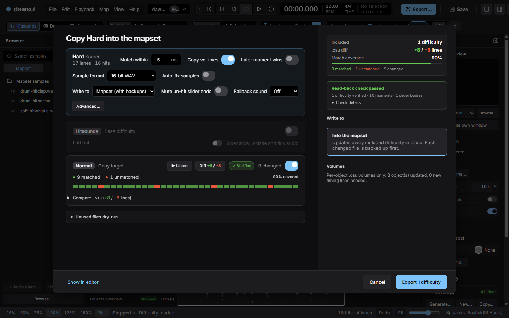

# Shared Base & Export

[Setting Up](Setting-Up.md) · [First Project](First-Project.md) · [Shared Base & Export](Shared-Base-and-Export.md) · [Drums, Stems & Keysounds](Drums-Stems-and-Keysounds.md) · [FAQ](FAQ.md) · [Reporting Bugs](Reporting-Bugs.md)

Once you have hitsounded one difficulty (such as `[Hard]` or `[Hitsounds]`), **dawsu!** gives you two ways to bring those hitsounds cleanly to the rest of your mapset and verify every `.osu` file before writing to disk.

## 1. Shared Base Layer (`Map → Shared Base layer…`)

Use the **Shared Base layer** when you want one shared hitsound arrangement across multiple difficulties while keeping per-difficulty adjustments non-destructive.

### Live diff tabs

- Toggle **Use Shared Base for this mapset** on and click **Capture current difficulty as Base** to snapshot the open difficulty's hitsound moments.
- Each difficulty tab and row shows live projection counts against the Base:
  - **Matched (`✓`):** Hits in the Base that land on an object in that difficulty within the match window.
  - **Empty (`○`):** Objects in that difficulty that do not yet have a hit in the Base.
  - **Orphaned (`!`):** Hits in the Base where that difficulty has no object (useful for catching extra rhythms from higher difficulties).
- Adjust **Match leniency (ms)** (default `5 ms`), optionally check **Overwrite per-difficulty overrides**, and click **Apply Base to this difficulty** or **Apply Base to all difficulties**.
- **Reset overrides** clears manual per-difficulty overrides on the open difficulty; **Clear Shared Base** removes the Shared Base for the mapset.

### Lane rules

Switch to the **Lane rules** tab and pick any difficulty chip at the top to add non-destructive rules on top of the Shared Base without modifying other difficulties:

- **Mute lane** — silence a sample lane across the whole difficulty or within a `start–end ms` time range (for example, muting heavy claps during a quiet verse on `[Normal]`).
- **Replace lane** — swap one sample lane for another across the whole difficulty or a time range.
- **Add hit** / **Remove hit** — add or remove a single hit at a specific `ms` timestamp (with volume `%` for **Add hit**).

### Volume curve (green-line only)

Switch to the **Volume curve** tab to shape loudness across your song without creating extra mixed `.wav` files:

- Set **Scope** to **Whole mapset (shared)** or **Current difficulty only**.
- `Ctrl+click` anywhere on the graph (or enter **Time (ms)**, **Volume %**, and **Linear** / **Step**) to add a point. Click an existing point once to select it and click again to flip between **Linear** ramps and **Step** holds.
- On export, dawsu! writes only `[TimingPoints]` green lines — zero extra sample files are generated for section volume changes.

## 2. Export Review (`Ctrl+E` or `Export…`)

Click **Export…** in the top bar (or press `Ctrl+E` / **File → Export…**) to preview and run multi-difficulty copying, `.osz`/folder export, sample optimization, and verification.

### Source & Export Options

- **Match within (ms):** Time window used to match source hits to target objects.
- **Copy volumes / Later moment wins:** Choose whether source volumes carry over and whether later moments replace earlier ones inside the match window.
- **Sample format:** Export mixed samples as **16-bit WAV**, **32-bit float WAV**, or **Ogg Vorbis**.
- **Auto-fix samples:** Trims leading silence and pads samples shorter than `25 ms` to help meet osu! Ranking Criteria.
- **Write to:**
  - **Mapset (with backups):** Writes directly into your mapset folder after taking automatic backups outside the mapset.
  - **Hitsound-only folder:** Writes a standalone folder (defaulting to the dawsu! exports folder, or **Choose folder…**) containing the song, samples, and hitsound `.osu` files while leaving your original mapset completely untouched.
- **Mute un-hit slider ends:** Automatically sets un-hit slider ends to `5%` volume when enabled (configure **Min length (beats)**, **Beat snap**, and **Also mute spinner ends**). Slider ends that already match a hitsound are never muted.
- **Fallback sound:** Optionally assign `Normal`, `Soft`, or `Drum` at a chosen `%` volume to target objects that did not match any source hit.
- **Advanced…:** Configure **Single samples** (`Keep original file` vs `Match mix format`), **Addition-only hitnormal** policy (`Difficulty set`, `Addition set`, `Skin Normal/Soft/Drum`, or `Silent (44 B WAV)`), **Slider ticks** (`Ignore` vs `Render green lines (+5 ms revert)`), **Apply volume curve**, **Allow schema growth**, **Auto-clean stale mixes**, and **Take over existing samples**.

### Target Cards, `.osu` Diffs & Pre-Write Read-Back Check

- Toggle any target difficulty on or off (`Base` hitsound difficulty and each copy target).
- Click **▶ Listen** on any target card to audition how that difficulty will sound before writing a single file.
- Inspect the **36-bin coverage strip** (`matched`, `unmatched`, `% covered`) and click **Diff +N / -M** to expand a section-by-section line diff of the exact `.osu` changes (cards with no text edits show **No .osu changes** or **Line endings only**).
- Expand **Unused files dry-run** at the bottom to preview which stale dawsu!-created sample files can be cleaned up safely.
- **Pre-write read-back check (`✓ Verified` / `✕ Check failed`):** Before any write runs, dawsu! re-parses the compiled output, checks structure, verifies envelope preservation, and confirms sample resolution. If any check fails, the sidebar displays **Read-back check failed — Export blocked** and refuses to write broken output to disk.

---

**Next:** Explore drum kits, AI stem separation, Node Graph detection, and Keysounding in [Drums, Stems & Keysounds](Drums-Stems-and-Keysounds.md).
